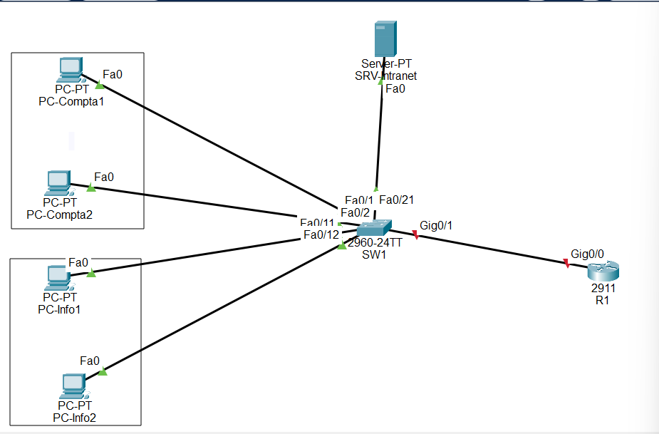
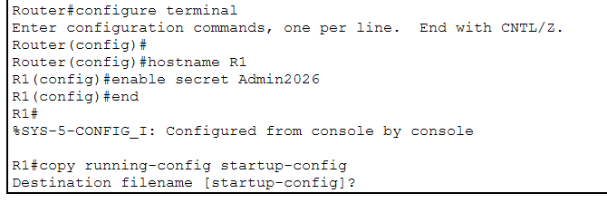
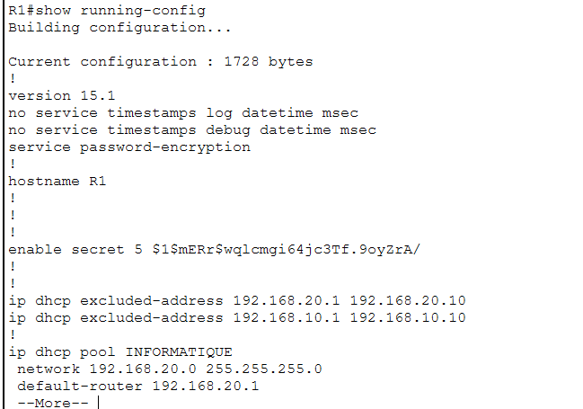
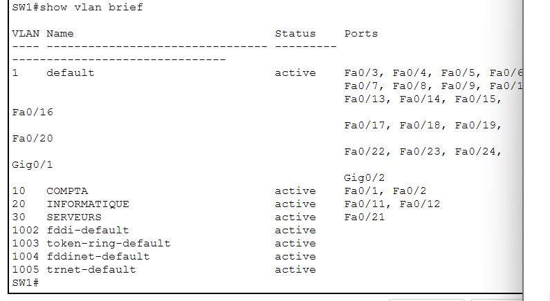
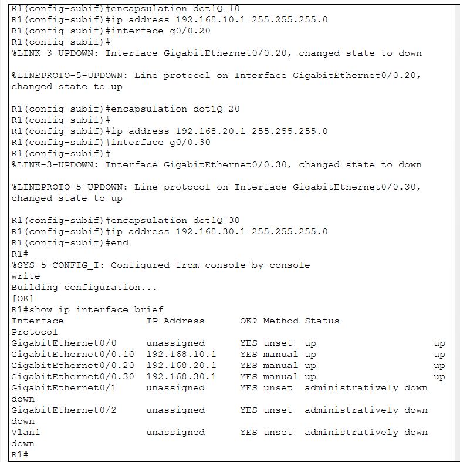
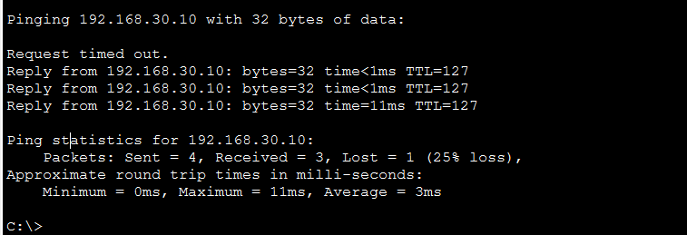
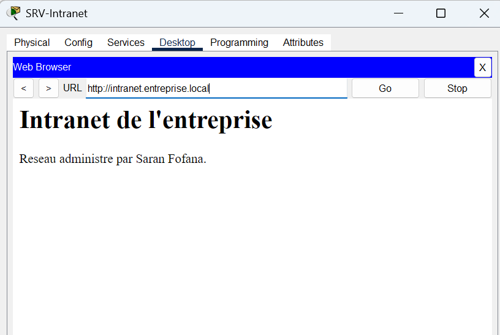
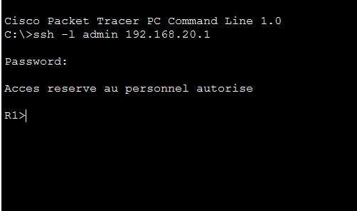
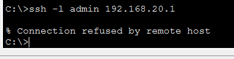
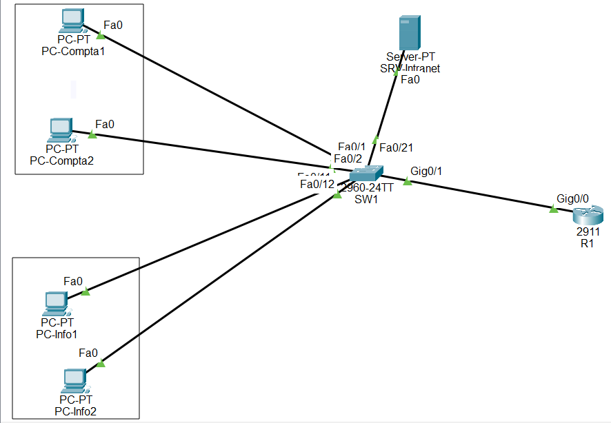

# Réseau d'entreprise sous Cisco Packet Tracer

Projet personnel de **réseau et administration** réalisé avec **Cisco Packet Tracer**.

L'objectif est de construire le réseau d'une petite entreprise qui a deux services, la **comptabilité** et l'**informatique**, ainsi qu'un **serveur**. Chaque service a son propre réseau isolé, les ordinateurs reçoivent leur adresse automatiquement, le serveur héberge un site intranet accessible par son nom, et seul le service informatique peut administrer le routeur à distance.

**Réalisé par :** Saran Fofana, étudiante en Master 1 Génie Informatique (Université Nangui Abrogoua, Abidjan)

---

## Sommaire

0. [Lexique : les termes à connaître](#0-lexique--les-termes-à-connaître)
1. [Topologie et plan d'adressage](#1-topologie-et-plan-dadressage)
2. [Configuration de base et sécurisation](#2-configuration-de-base-et-sécurisation)
3. [Les VLAN sur le switch](#3-les-vlan-sur-le-switch)
4. [Le routage entre les VLAN](#4-le-routage-entre-les-vlan)
5. [Le DHCP](#5-le-dhcp)
6. [Le serveur web et le DNS](#6-le-serveur-web-et-le-dns)
7. [SSH et ACL](#7-ssh-et-acl)
8. [Tests finaux et sauvegarde](#8-tests-finaux-et-sauvegarde)
9. [Difficultés rencontrées et solutions](#9-difficultés-rencontrées-et-solutions)
10. [Ce que j'ai appris](#10-ce-que-jai-appris)

## Fichiers du dépôt

| Fichier | Contenu |
| --- | --- |
| `reseau-entreprise.pkt` | Le projet complet, à ouvrir avec Cisco Packet Tracer |
| `R1_running-config.txt` | La configuration complète du routeur |
| `SW1_running-config.txt` | La configuration complète du switch |
| `captures/` | Les captures d'écran des tests |

---

## 0. Lexique : les termes à connaître

| Terme | Explication simple |
| --- | --- |
| **Routeur** | Équipement qui relie des réseaux différents entre eux et choisit le chemin des données. Ici, il relie les trois services. |
| **Switch** (commutateur) | Équipement qui relie les appareils d'un même réseau local (PC, serveur) grâce à leurs câbles. |
| **Adresse IP** | L'« adresse postale » d'un appareil sur le réseau, par exemple `192.168.10.11`. |
| **Masque de sous-réseau** (/24) | Indique quelle partie de l'adresse IP désigne le réseau. `/24` (ou `255.255.255.0`) veut dire que les appareils `192.168.10.x` sont dans le même réseau. |
| **Passerelle** (gateway) | L'adresse du routeur que l'appareil contacte pour sortir de son réseau. Sans elle, un PC ne peut parler qu'aux appareils de son propre réseau. |
| **VLAN** (réseau local virtuel) | Un découpage d'un switch en plusieurs réseaux séparés. Les PC de deux VLAN différents sont isolés, même s'ils sont branchés sur le même switch. |
| **Port access** | Port de switch qui appartient à **un seul** VLAN. On y branche un PC ou un serveur. |
| **Trunk** (802.1Q) | Port de switch qui transporte **plusieurs** VLAN sur un seul câble. Chaque trame reçoit une « étiquette » qui indique son VLAN. |
| **Routage inter-VLAN** (router-on-a-stick) | Technique où le routeur relie les VLAN entre eux par un seul câble trunk, découpé en **sous-interfaces** (une par VLAN). |
| **DHCP** | Service qui donne automatiquement une adresse IP, une passerelle et un serveur DNS à chaque appareil qui se branche. |
| **Bail DHCP** (binding) | L'association entre un appareil (son adresse MAC) et l'adresse IP qu'il a reçue. |
| **Adresse MAC** | L'identifiant unique de la carte réseau d'un appareil, gravé par le fabricant. |
| **DNS** | Service qui traduit un nom (`intranet.entreprise.local`) en adresse IP (`192.168.30.10`), comme un annuaire. |
| **Enregistrement A** | Une ligne de l'annuaire DNS qui associe un nom à une adresse IPv4. |
| **HTTP** | Le protocole utilisé pour afficher des pages web. |
| **SSH** | Protocole qui permet d'administrer un équipement **à distance** par une connexion **chiffrée**. Personne ne peut lire les mots de passe qui circulent. |
| **Telnet** | L'ancêtre de SSH, **non chiffré**. On l'interdit car les mots de passe circulent en clair. |
| **Clés RSA** | Les clés de chiffrement que le routeur génère pour sécuriser les connexions SSH. |
| **ACL** (liste de contrôle d'accès) | Une liste de règles qui autorise ou refuse le trafic selon son origine. Ici, elle n'autorise que le service informatique à administrer le routeur. |
| **Lignes VTY** | Les « portes d'entrée » virtuelles du routeur pour les connexions à distance (SSH). |
| **Ping** | Commande de test qui envoie un petit message à un appareil et attend sa réponse, pour vérifier qu'il est joignable. |
| **TTL** | Un compteur dans chaque paquet, qui diminue de 1 à chaque routeur traversé. Un TTL de 127 au lieu de 128 prouve que le paquet est passé par un routeur. |
| **running-config** | La configuration **en cours d'utilisation**, en mémoire vive. Elle est perdue si l'équipement redémarre. |
| **startup-config** | La configuration **enregistrée**, rechargée à chaque démarrage. On y copie la running-config pour la sauvegarder. |
| **Mode utilisateur** (`>`) et **mode privilégié** (`#`) | Les deux niveaux d'accès d'un équipement Cisco : `>` permet seulement de consulter, `#` permet d'administrer. |

---

## 1. Topologie et plan d'adressage

**But :** placer les équipements et les relier, puis définir le réseau de chaque service.

**Matériel :** 1 routeur Cisco 2911 (`R1`), 1 switch Cisco 2960 (`SW1`), 4 PC et 1 serveur (`SRV-Intranet`).

| VLAN | Service | Réseau | Passerelle | Ports du switch | Appareils |
| --- | --- | --- | --- | --- | --- |
| 10 | COMPTA | 192.168.10.0/24 | 192.168.10.1 | Fa0/1 – Fa0/2 | PC-Compta1, PC-Compta2 (DHCP) |
| 20 | INFORMATIQUE | 192.168.20.0/24 | 192.168.20.1 | Fa0/11 – Fa0/12 | PC-Info1, PC-Info2 (DHCP) |
| 30 | SERVEURS | 192.168.30.0/24 | 192.168.30.1 | Fa0/21 | SRV-Intranet (192.168.30.10, fixe) |

Le switch (port `Gi0/1`) est relié au routeur (port `G0/0`) par un **trunk**.



*📷 Capture [`01-topologie.png`](captures/01-topologie.png) — la topologie. Le lien entre SW1 et R1 est encore rouge : le port du routeur n'est pas encore allumé (étape 4).*

---

## 2. Configuration de base et sécurisation

**But :** donner un nom à chaque équipement et protéger son accès par des mots de passe, comme on le fait sur tout équipement neuf.

Commandes appliquées sur **R1** et sur **SW1** (avec `hostname SW1` sur le switch) :

```
enable                                  ! passer en mode privilégié (#)
configure terminal                      ! entrer en mode configuration
hostname R1                             ! donner un nom à l'équipement
enable secret Admin2026                 ! mot de passe chiffré du mode privilégié
service password-encryption             ! chiffrer les autres mots de passe dans la configuration
banner motd #Acces reserve au personnel autorise#   ! message d'avertissement à chaque connexion
no ip domain-lookup                     ! éviter qu'une faute de frappe bloque la console
line console 0                          ! la connexion par câble console
 password Console2026                   ! son mot de passe
 login                                  ! exiger ce mot de passe
 exit
end                                     ! revenir en mode privilégié
copy running-config startup-config      ! enregistrer la configuration (équivalent : write)
```

> Les mots de passe ci-dessus sont ceux du **lab**, uniquement pour cet exercice.



*📷 Capture [`02-config-r1.png`](captures/02-config-r1.png) — le routeur prend le nom R1 et reçoit son mot de passe `enable secret`.*



*📷 Capture [`02-config-chiffree.png`](captures/02-config-chiffree.png) — dans la configuration, le mot de passe apparaît chiffré (`enable secret 5 $1$…`).*

**Résultat :** les équipements portent leur nom, affichent un avertissement, et demandent deux mots de passe différents : un pour **entrer** (console) et un pour **administrer** (`enable`).

---

## 3. Les VLAN sur le switch

**But :** séparer le switch en trois réseaux virtuels, pour isoler la comptabilité, l'informatique et les serveurs.

Commandes sur **SW1** :

```
configure terminal
vlan 10                                 ! créer le VLAN 10
 name COMPTA                            ! lui donner un nom
vlan 20
 name INFORMATIQUE
vlan 30
 name SERVEURS
 exit
interface range fa0/1 - 2               ! les ports des PC de la comptabilité
 switchport mode access                 ! port d'accès : un seul VLAN
 switchport access vlan 10              ! ce VLAN
interface range fa0/11 - 12             ! les ports des PC de l'informatique
 switchport mode access
 switchport access vlan 20
interface fa0/21                        ! le port du serveur
 switchport mode access
 switchport access vlan 30
interface gi0/1                         ! le port vers le routeur
 switchport mode trunk                  ! transporte tous les VLAN
 end
write                                   ! enregistrer
show vlan brief                         ! vérifier la répartition des ports
```



*📷 Capture [`03-vlan.png`](captures/03-vlan.png) — chaque port est dans son VLAN : COMPTA (Fa0/1-2), INFORMATIQUE (Fa0/11-12), SERVEURS (Fa0/21).*

**Résultat :** les trois services sont isolés sur le même switch.

---

## 4. Le routage entre les VLAN

**But :** les VLAN sont isolés, mais les employés doivent quand même joindre le serveur. Le routeur sert de passerelle à chaque VLAN, grâce à un seul câble découpé en trois **sous-interfaces** (méthode *router-on-a-stick*).

Commandes sur **R1** :

```
configure terminal
interface g0/0
 no shutdown                            ! allumer le port (éteint par défaut sur un routeur)
interface g0/0.10                       ! sous-interface du VLAN 10
 encapsulation dot1Q 10                 ! elle traite les trames étiquetées VLAN 10
 ip address 192.168.10.1 255.255.255.0  ! passerelle de la comptabilité
interface g0/0.20
 encapsulation dot1Q 20
 ip address 192.168.20.1 255.255.255.0  ! passerelle de l'informatique
interface g0/0.30
 encapsulation dot1Q 30
 ip address 192.168.30.1 255.255.255.0  ! passerelle des serveurs
 end
write
show ip interface brief                 ! vérifier l'état des interfaces
```



*📷 Capture [`04-interfaces.png`](captures/04-interfaces.png) — G0/0 et ses trois sous-interfaces sont « up / up », avec les adresses des passerelles.*

**Résultat :** le lien entre le switch et le routeur passe au vert, et chaque VLAN a sa passerelle.

---

## 5. Le DHCP

**But :** le routeur distribue automatiquement une adresse IP, la passerelle et le serveur DNS à chaque PC, selon son VLAN. Les adresses `.1` à `.10` sont réservées aux équipements.

Commandes sur **R1** :

```
configure terminal
ip dhcp excluded-address 192.168.10.1 192.168.10.10   ! réserver la PLAGE .1 à .10 (VLAN 10)
ip dhcp excluded-address 192.168.20.1 192.168.20.10   ! idem pour le VLAN 20
ip dhcp pool COMPTA                     ! réserve d'adresses de la comptabilité
 network 192.168.10.0 255.255.255.0     ! réseau dans lequel piocher
 default-router 192.168.10.1            ! passerelle envoyée aux PC
 dns-server 192.168.30.10               ! serveur DNS envoyé aux PC
ip dhcp pool INFORMATIQUE
 network 192.168.20.0 255.255.255.0
 default-router 192.168.20.1
 dns-server 192.168.30.10
 end
write
show ip dhcp binding                    ! liste des adresses distribuées
```

Sur chaque PC : *Desktop → IP Configuration → DHCP*. Le serveur, lui, reçoit une **adresse fixe** : 192.168.30.10, passerelle 192.168.30.1, DNS 192.168.30.10.

Résultat sur PC-Compta2 (`ipconfig`) :

```
IPv4 Address....................: 192.168.10.12
Subnet Mask.....................: 255.255.255.0
Default Gateway.................: 192.168.10.1
```

**Résultat :** les PC de la comptabilité reçoivent `192.168.10.11` et `.12`, ceux de l'informatique `192.168.20.11` et `.12`.

---

## 6. Le serveur web et le DNS

**But :** le serveur héberge le site intranet de l'entreprise, et le DNS permet de l'ouvrir avec un nom plutôt qu'avec une adresse IP.

Configuration du serveur `SRV-Intranet` (onglet *Services*) :

- **HTTP** activé, avec une page d'accueil personnalisée (`index.html`) ;
- **DNS** activé, avec un enregistrement A : `intranet.entreprise.local` → `192.168.30.10`.

Test de routage depuis PC-Compta1 vers le serveur :

```
ping 192.168.30.10
```



*📷 Capture [`06-ping-serveur.png`](captures/06-ping-serveur.png) — le serveur répond avec un TTL de 127 : le paquet est passé par le routeur, d'un VLAN à l'autre. La première ligne « Request timed out » est normale (le temps que le réseau apprenne les adresses).*



*📷 Capture [`06-intranet.png`](captures/06-intranet.png) — le site s'ouvre avec l'adresse `http://intranet.entreprise.local` : le DNS traduit bien le nom en adresse IP.*

---

## 7. SSH et ACL

**But :** administrer le routeur à distance de façon chiffrée (SSH), et n'autoriser **que le service informatique** à s'y connecter (ACL).

Commandes sur **R1** :

```
configure terminal
ip domain-name entreprise.local         ! nom de domaine, nécessaire pour créer les clés
username admin secret Ssh2026           ! compte d'administration, mot de passe chiffré
crypto key generate rsa general-keys modulus 1024   ! créer les clés de chiffrement SSH
ip ssh version 2                        ! utiliser la version 2, la plus sûre
access-list 10 permit 192.168.20.0 0.0.0.255   ! autoriser seulement le réseau INFORMATIQUE
line vty 0 15                           ! les lignes de connexion à distance
 login local                            ! se connecter avec le compte admin
 transport input ssh                    ! SSH uniquement, Telnet interdit
 access-class 10 in                     ! appliquer l'ACL aux connexions entrantes
 end
write
```

> Une ACL se termine toujours par un **refus implicite** : tout ce qui n'est pas autorisé est refusé. Ici, seul `192.168.20.0/24` est autorisé.

Test depuis un PC de l'**informatique** :

```
ssh -l admin 192.168.20.1
```



*📷 Capture [`07-ssh-ok.png`](captures/07-ssh-ok.png) — depuis l'informatique, la connexion réussit : la bannière s'affiche et on arrive sur `R1>`.*

Même test depuis un PC de la **comptabilité** :



*📷 Capture [`07-ssh-refus.png`](captures/07-ssh-refus.png) — depuis la comptabilité, la connexion est refusée par l'ACL (« Connection refused by remote host »).*

**Résultat :** seul le service informatique peut administrer le routeur, et toujours par une connexion chiffrée.

---

## 8. Tests finaux et sauvegarde

**But :** vérifier que la configuration est bien **enregistrée**, en redémarrant tous les équipements (*Power Cycle Devices*), puis en refaisant un test.



*📷 Capture [`08-topologie-finale.png`](captures/08-topologie-finale.png) — le réseau final : tous les liens sont verts, y compris le trunk entre SW1 et R1.*

Après le redémarrage, le `ping` de PC-Compta1 vers le serveur répond toujours (voir [`06-ping-serveur.png`](captures/06-ping-serveur.png)) : les VLAN, le routage et le DHCP ont été conservés.

Les configurations complètes ont été exportées depuis Packet Tracer (*Config → Settings → Running Config → Export*) :

- [`R1_running-config.txt`](R1_running-config.txt)
- [`SW1_running-config.txt`](SW1_running-config.txt)

Grâce à `service password-encryption`, les mots de passe y apparaissent chiffrés.

---

## 9. Difficultés rencontrées et solutions

| Problème | Cause | Solution |
| --- | --- | --- |
| `% Ambiguous command: "en secret"` | `en` peut vouloir dire `enable` ou `end` | Écrire la commande en entier : `enable secret` |
| `% Incomplete command` sur `hostname` | Le nom avait été oublié | `hostname R1` |
| Lien rouge entre le switch et le routeur | Les ports d'un routeur sont éteints par défaut | `no shutdown` sur l'interface G0/0 |
| Les PC de la compta recevaient `.2` et `.3` au lieu de `.11` | Deux exclusions séparées (`.1` et `.10`) au lieu d'une plage | Suppression avec `no`, puis `ip dhcp excluded-address 192.168.10.1 192.168.10.10`, et renouvellement de l'adresse des PC |
| `clear ip dhcp binding *` et `terminal length 0` refusés | Commandes non prises en charge par Packet Tracer | Renouvellement DHCP depuis les PC, et export de la configuration depuis l'onglet Config |

---

## 10. Ce que nous appris  

- Segmenter un réseau avec des **VLAN** et relier les VLAN avec un **trunk** et le **routage inter-VLAN**.
- Configurer un service **DHCP** et comprendre les plages d'exclusion et les baux.
- Mettre en place un serveur **web** et un **DNS**.
- Sécuriser des équipements Cisco : mots de passe chiffrés, bannière, **SSH** et **ACL**.
- Faire la différence entre la **running-config** et la **startup-config**, et toujours enregistrer.
- Diagnostiquer avec `ping`, le **TTL**, `show ip interface brief`, `show vlan brief` et `show ip dhcp binding`.
